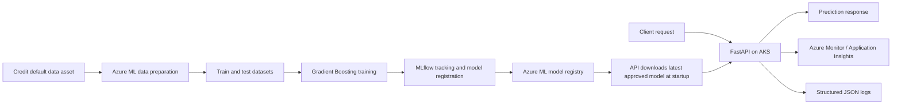

# Credit Default Prediction MLOps Platform

An incremental, end-to-end machine learning project for developing and operating a credit-default prediction service on Microsoft Azure. It brings together data preparation, model training and registration, a FastAPI inference service, containerization, Kubernetes deployment, infrastructure as code, and application telemetry.

> **Project status:** Work in progress. This repository captures the current implementation; deployment, monitoring, security, and operational capabilities are being added and refined incrementally. Items marked as planned are not yet represented as complete functionality.

## What this project demonstrates

- Building an Azure Machine Learning pipeline from reusable command components.
- Preparing a train/test split, training a scikit-learn classifier, and tracking/registering a model with MLflow.
- Loading an approved model from Azure ML and serving predictions through a typed FastAPI API.
- Packaging the service in Docker and deploying it to AKS with Kubernetes manifests and Helm.
- Defining Azure infrastructure with Bicep and automating infrastructure and application deployment with Azure DevOps Pipelines.
- Instrumenting an API with Azure Monitor OpenTelemetry and structured application logs.
- Developing a cloud solution incrementally, documenting implementation status and next steps.

## End-to-end flow



### Machine learning workflow

The code in `model_training/` defines an Azure ML pipeline with two command components:

1. **Data preparation** reads `default_of_credit_card_clients.csv`, records sample and feature counts, and writes train/test CSV files. The split ratio is configurable; the current configuration uses 25% for testing.
2. **Model training** reads those datasets, separates the `default payment next month` label, trains a `GradientBoostingClassifier`, prints a classification report, and logs the model with MLflow for registration. It also saves a model artifact to the pipeline output.

The pipeline uses the latest named Azure ML environment and data asset, submits a job under the configured experiment name, and streams its output. `model_training/src/run_all_script.py` loads a selected environment-variable file and launches the pipeline script. Training uses `AzureCliCredential`; serving uses `DefaultAzureCredential`.

> The current training script reports classification metrics to job output and registers the model, but a formal evaluation gate, reproducible split seed, and automated promotion workflow are not yet implemented.

### Inference service

The `serving/` application is a FastAPI service packaged with Docker. At startup, it downloads the latest model version tagged `status=approved` from Azure ML and loads it through MLflow. Requests are checked against a Pydantic schema, and features are reordered to match the model's training-time feature list before prediction.

| Endpoint | Purpose |
|---|---|
| `GET /` | Service welcome response |
| `GET /health` | Basic health response |
| `GET /health/live` | Liveness response |
| `GET /health/ready` | Readiness check; returns `503` until the model is loaded |
| `POST /predict` | Predicts credit default from the 23 input features |

`POST /predict` returns a request ID, a prediction (`0` or `1`) with a human-readable label, and measured request latency. The request ID is also returned in the `X-Request-ID` response header.

Example request shape:

```json
{
  "LIMIT_BAL": 20000,
  "SEX": 2,
  "EDUCATION": 2,
  "MARRIAGE": 1,
  "AGE": 24,
  "PAY_0": 2,
  "PAY_2": 2,
  "PAY_3": 0,
  "PAY_4": 0,
  "PAY_5": 0,
  "PAY_6": 0,
  "BILL_AMT1": 3913,
  "BILL_AMT2": 3102,
  "BILL_AMT3": 689,
  "BILL_AMT4": 0,
  "BILL_AMT5": 0,
  "BILL_AMT6": 0,
  "PAY_AMT1": 0,
  "PAY_AMT2": 689,
  "PAY_AMT3": 0,
  "PAY_AMT4": 0,
  "PAY_AMT5": 0,
  "PAY_AMT6": 0
}
```

Example response:

```json
{
  "request_id": "generated-request-id",
  "prediction": {
    "prediction": 0,
    "prediction_label": "No Default"
  },
  "latency_ms": 12.34
}
```

## Cloud platform and delivery

### Infrastructure

The Bicep templates define an Azure Container Registry and an Azure Kubernetes Service cluster. The AKS cluster has a system-assigned identity, and the template grants it pull access to ACR. A separate storage template defines a storage account and blob container. The main Bicep entry point currently composes the ACR and AKS modules.

### Container and Kubernetes

The Docker image uses Python 3.8, installs `serving/requirements.txt`, and runs Uvicorn on port 8000. Kubernetes resources and the Helm chart define the API deployment, service, ingress, configuration, secret reference, and service account. The deployment is configured for two replicas, and the pod template opts into Azure Workload Identity.

### CI/CD

Azure DevOps pipeline definitions are provided for:

- **Application deployment:** builds the serving image, pushes it to ACR, upgrades the Helm release, and waits for the AKS deployment rollout.
- **Infrastructure:** validates Bicep, runs an Azure deployment `what-if`, deploys the infrastructure, and installs the NGINX ingress controller.
- **Training:** the Python pipeline implementation is in `model_training/src/pipeline.py`; the Azure Pipelines training YAML is a work in progress.

Pipeline execution depends on Azure DevOps service connections, variable groups, permissions, and Azure resources configured in the target environment.

## Monitoring and observability

The serving application includes Azure Monitor OpenTelemetry configuration and FastAPI instrumentation. Its JSON logs are written to standard output and can include timestamps, severity, event names, request IDs, prediction values, latency, and error details. The prediction endpoint measures request latency, and the health endpoints provide basic service and model-readiness signals.

Monitoring integrations and logging code are present; complete operational dashboards, alert rules, service-level objectives, and model/data quality monitoring are future work. Kubernetes liveness and readiness probes are not currently enabled in the deployment manifests.

## Technology stack

| Area | Technologies |
|---|---|
| Machine learning | Azure Machine Learning, scikit-learn, Gradient Boosting, MLflow |
| Data handling | Python, pandas |
| API | FastAPI, Pydantic, Uvicorn |
| Packaging and orchestration | Docker, Kubernetes, AKS, Helm |
| Infrastructure | Azure Bicep, Azure Container Registry, Azure Storage |
| Identity | Azure Identity, `DefaultAzureCredential`, Azure Workload Identity, Azure RBAC |
| Telemetry | Azure Monitor, Application Insights, OpenTelemetry, structured JSON logging |
| Automation | Azure DevOps Pipelines |

## Repository layout

```text
.
|-- README.md
|-- requirements.txt
|-- docs/
|   |-- architecture.md
|   |-- deployment-guide.md
|   |-- monitoring.md
|   `-- screenshots/
|-- helm/
|   `-- credit-default/
|       |-- Chart.yaml
|       |-- values.yaml
|       `-- templates/
|-- infra/
|   |-- main.bicep
|   |-- acr.bicep
|   |-- aks.bicep
|   |-- storage.bicep
|   `-- params/
|-- kubernetes/
|-- model_training/
|   |-- components/
|   |   |-- data_prep/
|   |   `-- train/
|   |-- config/
|   |-- dependencies/
|   |-- environment_variables/
|   `-- src/
|-- pipelines/
|   `-- azure-pipelines/
`-- serving/
    |-- app.py
    |-- schema.py
    |-- score.py
    |-- download_model.py
    |-- logger.py
    `-- Dockerfile
```

## Getting started

This project requires an Azure environment; training and inference depend on Azure ML assets, credentials, and resources configured for the developer or deployment environment.

### Prerequisites

- Python 3.8 for the current model-training environment and serving image.
- An Azure subscription and Azure Machine Learning workspace.
- Azure CLI and Azure ML permissions for the operations you intend to run.
- Docker for building the serving image.
- Kubernetes and Helm tooling for AKS deployment.
- Azure DevOps service connection and variable groups for pipeline execution.

### Run the training pipeline

1. Configure the Azure ML workspace, compute, data asset, environment, and pipeline settings.
2. Set the required environment variables in the selected local environment file. Keep credentials and secrets out of source control.
3. From the project root, run:

   ```bash
   python model_training/src/run_all_script.py --env level1
   ```

   The environment selector can be `level1`, `level2`, or `level3`, matching the files under `model_training/environment_variables/`.

### Run the API locally

Configure Azure ML workspace access and the `MODEL_NAME` setting, then install the serving dependencies and start the application:

```bash
python -m pip install -r serving/requirements.txt
cd serving
uvicorn app:app --host 127.0.0.1 --port 8000
```

The service needs access to an approved model in Azure ML at startup. Supply `APPLICATIONINSIGHTS_CONNECTION_STRING`: the current application configures Azure Monitor unconditionally, even when the variable is missing.

### Deploy

Use the Azure DevOps pipelines and Helm chart as the deployment path. Before running them, configure the Azure service connection, variable group, target resource group and cluster, Azure ML settings, and workload identity federation for the Kubernetes service account. Review and supply environment-specific values using your organization's secret-management practices.

## Security notes

- Use Azure Workload Identity and least-privilege RBAC for workload access where configured.
- The API uses `DefaultAzureCredential` to obtain Azure credentials from its runtime environment.
- Keep credentials, tokens, and Application Insights connection strings out of committed configuration. Use protected pipeline variables or a suitable secret store for sensitive settings.
- Review chart values, Kubernetes secrets, identity federation, and Azure role assignments before deploying to a shared or production environment.

## Roadmap

Planned incremental improvements include:

- Complete and validate training and deployment automation.
- Add repeatable model evaluation, data validation, and controlled model promotion.
- Enable Kubernetes probes and define resource requests/limits.
- Add Azure Monitor dashboards, alert rules, and service-level indicators.
- Add data drift and model performance monitoring.
- Add load testing, deployment strategies such as canary or blue/green, and operational runbooks.

## Documentation

- [Architecture](docs/architecture.md): system design, model lifecycle and current boundaries.
- [Training and deployment guide](docs/deployment-guide.md): prerequisites, setup and deployment steps.
- [Monitoring guide](docs/monitoring.md): available signals, troubleshooting and planned monitoring.

Screenshots can be added under `docs/screenshots/` as the project evolves.

## License

MIT
