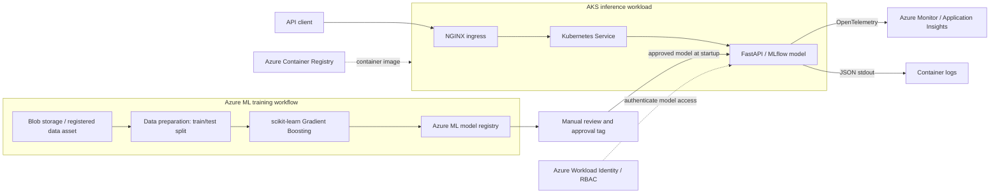

# Architecture: Credit Default Prediction

[Project overview](../README.md) | [Deployment guide](deployment-guide.md) | [Monitoring guide](monitoring.md)

This project illustrates a reusable path from a tabular classification dataset to a cloud-hosted prediction API. It is an evolving implementation, not a production-ready reference deployment: the diagrams show the design represented by the repository, and the limitations below identify work still needed.

## System overview

The identity federation, role assignments, ingress controller, Azure ML workspace and monitoring resource require environment-specific setup; they are not all provisioned by the main Bicep template. The chart contains workload identity annotations, but these alone do not configure federation or grant access.

## Training and model lifecycle

1. A registered Azure ML `uri_folder` data asset points to a folder containing `default_of_credit_card_clients.csv`. The preparation script reads the second CSV row as the header and uses the first column as the index.
2. The preparation component splits the data into training and test files and logs the number of samples and features with MLflow.
3. The training component removes the `default payment next month` label, fits a `GradientBoostingClassifier`, prints a classification report, and logs and registers the model with MLflow. The pipeline also writes a saved model artifact.
4. A model version must be reviewed and tagged `status=approved` separately; training does not automatically apply this tag. The service selects the highest **numeric** approved version at startup.
5. On each API startup, the service downloads that version and loads it with `mlflow.pyfunc`. A new approval is not automatically reloaded into running pods.

The pipeline uses configurable data, environment, split ratio, learning rate, model name and compute target. The current split is not seeded, evaluation metrics are printed rather than used as a promotion gate, and the latest data/environment version lookup compares versions as strings. Use explicit versioning or verify the selected versions before relying on repeatable deployments.

## Prediction path

1. A client reaches the API through ingress and the Kubernetes service.
2. FastAPI validates the JSON body using the `PredictionRequest` schema.
3. The scoring code orders the 23 fields according to `FEATURE_COLUMNS`, creates a single-row DataFrame and invokes the loaded model.
4. The response includes the class, label, request ID and elapsed time. The request ID is also returned in `X-Request-ID` for successful requests.

`/health/live` responds when the application is running. `/health/ready` checks whether a model has loaded, but its `model_version` response is currently hard-coded and must not be used to identify the actual registered version. The Helm deployment does not currently configure Kubernetes probes, so these endpoints are not automatically used to control pod readiness or restarts.

## Infrastructure and delivery boundaries

| Area | Repository implementation | Important boundary |
|---|---|---|
| Infrastructure | `infra/main.bicep` composes ACR and AKS; `infra/storage.bicep` is a separate template | Workspace, compute, identity federation and monitoring are external prerequisites |
| Application | `serving/` contains the API, model loader, scorer and Dockerfile | Startup depends on Azure access and an approved model |
| Orchestration | `helm/credit-default/` and `kubernetes/` define service, ingress, deployment and configuration | Review values, exposure, resource limits and probes before deployment |
| Automation | Azure DevOps definitions build/deploy the image and deploy infrastructure | Paths in the pipeline definitions currently assume the project files are at the checkout root; training pipeline YAML is empty |
| Observability | FastAPI instrumentation, a health span and structured stdout logs | Dashboards, alerts, drift and model performance monitoring are not implemented in the repository |

The infrastructure template assigns an ACR pull role to the AKS system-assigned identity. Confirm that the actual cluster image-pull identity has ACR access in the target environment.

## Design considerations

- **Separation of concerns:** training produces model artifacts; serving loads a registered, approved artifact rather than retraining on requests.
- **Configurable components:** the Azure ML pipeline separates data preparation from model training and passes outputs explicitly.
- **Identity:** training scripts use `AzureCliCredential`; serving uses `DefaultAzureCredential` and can use workload identity when AKS federation and permissions are configured.
- **Observability:** API telemetry and JSON logs give a starting point for investigating traffic and failures, not a complete monitoring strategy.
- **Safety:** predictions are examples of a technical ML workflow, not an automated credit-decision system. Real use requires validation, fairness, privacy, security and regulatory review.

## Next steps

Add deterministic data splitting and version selection, evaluation and approval gates, reproducible deployment settings, automated tests, Kubernetes probes and limits, and production-grade security and monitoring controls.

## Screenshots

Suggested additions: an Azure ML pipeline run and an AKS deployment overview. Place redacted images in `docs/screenshots/` and link them here once available.